# Kaotim

> *kautim* (Malaysian slang): settled, sorted, done.

**Kaotim is a Cursor plugin that turns an AI coding agent into a disciplined engineering pipeline:
plan → test-first build → layered review → cleanup → pull request.** A main orchestrator agent
talks to you and delegates to ten specialist subagents, while deterministic Python scripts, not
LLM opinion, decide when each stage is done.

> **Status: early development.** Only **Milestone 0 (platform spikes)** is complete. The pipeline,
> commands, agents and CLI described below are the design being built in M1–M8; anything not
> marked *present* does not exist yet. See [Roadmap](#roadmap).

---

## Why it exists

AI-generated code fails in predictable ways: it guesses requirements, edits tests until they
pass, touches files it shouldn't, reinvents existing helpers, leaves debug code behind, and
declares victory without evidence. Prompting harder doesn't fix that. Kaotim's answer is
**structure plus enforcement**:

- Requirements, edge cases and architecture choices are decided by you in a planning
  conversation, never assumed.
- Tests are written first, must fail *for the right reason*, and are then locked so the
  implementer cannot quietly change them.
- Every stage transition is checked by a script against files on disk.
- Every run produces metrics (time, iterations, quality signals, estimated tokens) so the plugin
  itself can be measured and improved.

## How it works

### Hub-and-spoke

```
main agent (orchestrator + planner)
  ├─ talks to you (questions, choices, checkpoints)
  ├─ runs scripts for every state change, gate and metric
  └─ spawns subagents:
       explorer · test-writer · feature-dev (×N parallel)
       supervisor · structure-reviewer · refactorer
       bug-reviewer · fixer · cleaner · pr-writer
```

The orchestrator never reads source files; it reads `state.json`, script JSON output and compact
subagent handoffs, which keeps its context small. Reviewers return findings; the orchestrator
routes them to the right writer. Subagents never spawn subagents (enforced as policy, since Cursor
now technically allows one nested level; see [decisions](docs/decisions.md) D1).

### Pipeline (state machine)

Transitions are enforced by `kaotim.py next-stage`, never improvised by the model.

```mermaid
stateDiagram-v2
    direction LR
    [*] --> recon
    recon --> plan: stack.yaml + profile valid
    plan --> plan_approved: check-plan passes + user approves
    plan_approved --> contracts: plan has C0
    plan_approved --> tdd_red: no shared contracts
    contracts --> tdd_red: contracts merged, build gate green
    tdd_red --> tdd_green: verify-red OK + tests locked
    tdd_green --> integrate: all tasks done, ownership OK
    integrate --> supervisor: worktrees merged, full gate green
    supervisor --> tdd_green: reject (affected tasks only)
    supervisor --> structure_review: approve
    structure_review --> bug_review: no violations / refactor green
    bug_review --> cleanup: no blocking bugs / fixes green
    cleanup --> final_gate: full gate green
    final_gate --> pr: lock + ownership + metrics + user approves
    pr --> [*]
    note right of plan_approved
        Any stage -> escalated (cap reached,
        blocked handoff) or aborted
    end note
```



Human checkpoints are limited to three: the planning conversation, escalations, and approval
before the PR is opened (shown alongside the run's metrics summary). A **fast lane** (user
confirmed, never silent) skips contracts, parallel split and the full review chain for small,
single-package changes.

### Specialist subagents

| Agent | Mode | Job |
|---|---|---|
| `explorer` | read-only | Find existing utilities, patterns and entry points |
| `test-writer` | tests only | Write failing tests per acceptance criterion / edge case |
| `feature-dev` | write (owned files) | Make the locked tests pass; parallel, one per task |
| `supervisor` | read-only | Check the result against the plan's acceptance criteria |
| `structure-reviewer` | read-only | Flag layering and structure violations |
| `refactorer` | write | Behaviour-preserving fixes for structure findings |
| `bug-reviewer` | read-only | Find bugs, ranked by severity |
| `fixer` | write | Fix bugs with regression tests |
| `cleaner` | write (diff only) | Remove debug code, dead imports, leftovers |
| `pr-writer` | read-only | Write the PR body with an AC → test → status table |

Each agent gets a model tier (fast / standard / strong) mapped in
[`config.defaults.yaml`](config.defaults.yaml).

## Design principles

- **Scripts decide, LLMs judge.** Anything checkable (tests pass, lint clean, file ownership,
  layer imports, plan consistency, stage transitions, metrics) is a script. LLMs only plan,
  write code and tests, and do semantic review.
- **Files are shared memory.** Plan, state, handoffs, gate output and metrics live under
  `.kaotim/`; a fresh chat can resume any run from `state.json`.
- **TDD with teeth.** `verify-red` rejects tests that fail for the wrong reason (import errors,
  syntax errors, empty JUnit); test files are hash-locked and checked by hooks and every gate.
- **No collisions.** Each parallel task runs in its own git worktree with declared file
  ownership; `check-ownership` fails out-of-scope edits; merges are ordered and conflicts escalate.
- **Bounded loops.** Every retry/review loop has a cap; hitting it stops for a human with a
  summary of what was tried.
- **Token efficiency by design.** Thin orchestrator context, size-capped handoffs, trimmed gate
  output, short prompts.
- **Stack-agnostic engine, stack knowledge in adapters.** Ecosystem specifics (detection,
  commands, test parsing, import layering, safety guards) live in adapters; the generated
  `stack.yaml` is committed to your repo.

## Commands (planned)

| Command | Purpose |
|---|---|
| `/kaotim <request>` | Run the full pipeline for a feature (or resume) |
| `/kaotim-plan <request>` | Planning only |
| `/kaotim-resume` | Continue an interrupted run, ideally in a fresh chat |
| `/kaotim-stack` | Once per repo: detect the stack and generate `.kaotim/stack.yaml` |
| `/kaotim-init` | Generate stack rules and the project profile |
| `/kaotim-doctor` | Verify commands, wiring and test-database safety |
| `/kaotim-refresh` | Propose updates after the stack or structure changes (diff, never overwrites edits) |
| `/kaotim-metrics` | Show the run summary or trends across runs |
| `/kaotim-retro` | Propose plugin/config improvements from metrics history |

All commands are backed by a single CLI, `scripts/kaotim.py` (Python 3.9+, standard library
only, plus a vendored pure-Python YAML loader), so it runs in any repo with no install step.

## Supported stacks (planned)

| Stack | Support |
|---|---|
| **PHP / Laravel** (`php-laravel`) | Built-in: Pest and PHPUnit via JUnit, wrong-reason detection, affected-test mapping, layer checks, test-DB safety guards |
| **Python** (`python`) | Built-in: pytest via JUnit, ruff, mypy, uv-aware commands, layer checks |
| Anything else | Declarative adapter generated and reviewed per repo; commands-only, with reduced guarantees reported |

Multiple ecosystems in one repo each get their own stack and adapter. Monorepo behaviour is v2.

## Requirements

- Cursor with plugin support (IDE, or the Cursor CLI `agent`)
- Python 3.9+ on `PATH` as `python3` (macOS needs Xcode CLT; native Windows has no Python by
  default, so use WSL; see [findings V10](docs/platform-findings.md#v10-python-availability))
- Git, a clean working tree, and tests that run locally against a **safe** test database
- Optional: GitHub CLI `gh` to open PRs (otherwise the PR body is written to a file)

## Install for local development

There is nothing usable to install yet beyond the M0 spike. When the plugin exists, local
installs follow the verified Cursor mechanism:

```bash
# IDE: copy (don't symlink) into the local plugins folder, then
# "Developer: Reload Window" and check Customize
cp -r /path/to/kaotim ~/.cursor/plugins/local/kaotim

# CLI
agent --plugin-dir /path/to/kaotim
```

Notes: a marketplace install with the same name wins over a local copy, and Enterprise admins
can disable local plugins. To try the M0 spike plugin, see [`spike/README.md`](spike/README.md).

## Repository layout

| Path | Status | Contents |
|---|---|---|
| `docs/platform-findings.md` | present | M0 answers to all platform questions, with evidence |
| `docs/decisions.md` | present | Per-milestone decisions and spec deviations |
| `config.defaults.yaml` | present (draft) | Default caps, budgets, model-tier mapping |
| `fixtures/` | present | `laravel-app` (Pest), `laravel-app-phpunit`, `python-app` (uv, pytest, ruff, mypy) |
| `spike/` | present (throwaway) | M0 spike plugin, probe scripts, recorded evidence |
| `.cursor-plugin/plugin.json` | planned (M1) | Plugin manifest |
| `scripts/kaotim.py`, `scripts/lib/` | planned (M1+) | The CLI and shared libraries |
| `commands/`, `agents/`, `skills/`, `rules/` | planned (M2–M7) | Slash commands, subagents, skills, rules |
| `hooks/hooks.json` | planned (M4–M5) | Test-lock, ownership and stage-guard hooks |
| `adapters/`, `templates/` | planned (M1–M6) | Ecosystem adapters, plan/stack/handoff templates |
| `docs/user-guide.md` | planned (M8) | End-user guide |

## Roadmap

- [x] **M0 – Platform spikes:** verify Cursor plugin/subagent/hook behaviour, run adapters on fixtures
- [ ] **M1 – Foundations:** manifest, CLI skeleton, atomic state, plan parser, handoff checks, metrics log, adapter interface
- [ ] **M2 – Stack generation:** `detect-stack`, `validate-stack`, `/kaotim-stack`, `-init`, `-doctor`, `-refresh`
- [ ] **M3 – Planning:** planning/edge-case/arch-comparison skills, `explorer`, `check-plan`, `/kaotim-plan`
- [ ] **M4 – Single-task TDD:** `test-writer`, `feature-dev`, `verify-red`, test locks, gates, runner adapters
- [ ] **M5 – Multi-task & integration:** contracts, worktrees, `merge-tasks`, ownership checks, parallel agents
- [ ] **M6 – Review chain:** supervisor, structure review + `check-layers`, bug review, fixer, cleaner
- [ ] **M7 – PR, metrics, resume, fast lane:** `pr-writer`, metrics summary and history, `/kaotim-resume`, `/kaotim-retro`
- [ ] **M8 – Hardening:** end-to-end fixture runs, token-budget tests, user guide

## Platform findings (M0)

M0 checked every assumption the design makes about Cursor against official docs, Cursor's own
plugin repos and live runs on the box. Highlights that changed the design:

- **Plugin format:** `.cursor-plugin/plugin.json` with default folder discovery; local dev via
  `~/.cursor/plugins/local/<name>` or `agent --plugin-dir`.
- **No `beforeFileEdit` hook:** test locks use a `preToolUse` deny plus hash verification in every
  gate (shell writes aren't caught by hooks).
- **`stop` hooks can't block:** the stage guard uses a bounded `followup_message` instead.
- **No plugin-root variable in prompts:** `/kaotim-init` copies the CLI into `.kaotim/bin/`
  with a version stamp that `doctor` checks.
- **No token counts exposed:** tokens are estimated; model, durations and counts are measured.
- **Test runners verified:** Laravel (Pest/PHPUnit) and Python commands run from each stack root,
  including fresh worktrees; JUnit is authoritative, and empty JUnit or an `ImportError` inside a
  pytest `<failure>` count as wrong-reason red.

Cursor runtime behaviour is marked `docs-only` where the CLI couldn't be authenticated on the
build box; `spike/run_cli_spike.sh` upgrades those findings to `verified`. Full details:
[docs/platform-findings.md](docs/platform-findings.md) and [docs/decisions.md](docs/decisions.md).

## License

TBD. No license has been chosen yet; until one is added, all rights are reserved.

## Author

Dong Lin Wong ([@wongdlin](https://github.com/wongdlin))
