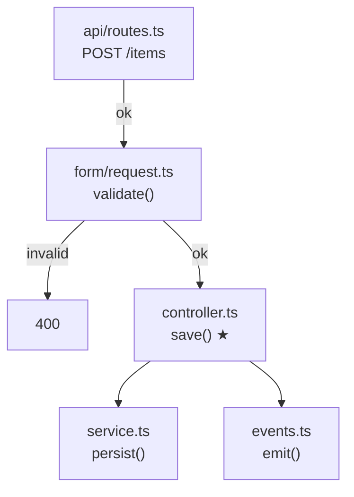

# Kaotim tree

Trace the selected / attached code as a call-flow tree. Extra focus if given: $ARGUMENTS

Trace the **selected or attached** symbol. Output a compact Mermaid flow plus tiny key snippets. Minimize tokens: search first, open little, write little. All upstream to entry points; one downstream hop only. Do not change the code.

## Scope

| Axis | Rule |
|---|---|
| Upstream | **All hops** until an entry (HTTP/route handler, CLI, job/consumer, test, or no callers) |
| Downstream | **Exactly 1 hop** from the selection (direct callees only) |
| Snippets | Decision / boundary / call-site lines only |
| Branches | Control-flow edges that change whether the selection (or a callee) runs |

## Hard caps

- Max **8** upstream nodes. If more: shortest path(s) from nearest entries → selection, then `+N other callers`.
- Max **6** downstream nodes. Collapse same-file trivial helpers; skip loggers, pure getters, obvious framework noise.
- Max **3** branch labels per node; prefer edge labels over extra nodes.
- Per node: ≤**3** snippet lines **or** one short paraphrase — only if non-obvious.
- ≤**5** bullets under Key snippets. No essay. Do not restate the selection at length.

## Workflow

1. Resolve the symbol from the selection (enclosing function/method if a line). Mark it `★`.
2. **Upstream:** Grep callers; walk up. Confirm each hop with small Grep context (`-B 1 -A 2`), not whole-file reads. Stop at entry / cap / ambiguity.
3. **Downstream:** Grep direct callees of the selection only. Do not recurse.
4. Note branches as edge labels (`ok`, `invalid`, `auth fail`, unconditional).
5. Uncertain static edges → `?` on the edge; do not speculative-read the repo.
6. Emit the output shape below. Stop.

## Output shape

1. **Mermaid** `flowchart TD` — nodes: `path/file`<br/>`symbol()`. `★` on selection. Upstream above, one downstream layer below. Branch conditions on edges.
2. **Key snippets** — only non-obvious edges/guards (omit section if none):

```
A→B: <≤3 lines or one paraphrase>
```

3. **Open** — one line each for unresolved `?` edges or capped callers. Omit if none.

### Example skeleton



```
V→S: if (!valid) return 400
```

## Rules

- Prefer Grep/Glob; Read only to confirm a call site or extract a snippet.
- Relative paths from project root.
- Do not rewrite code, invent callees, or expand past the caps.
- If nothing is selected/attached, ask for a selection in one short line — then stop.
